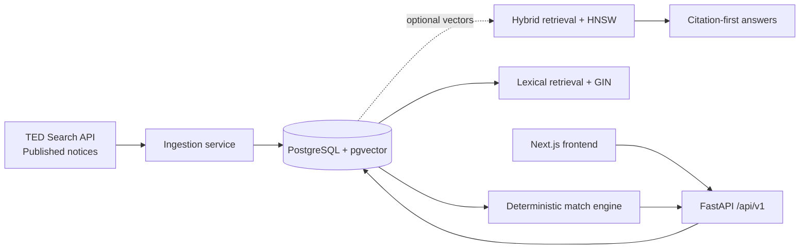

# TenderLens AI

TenderLens AI is a Docker-first public-procurement intelligence workspace for Belgian and EU opportunities. It discovers official TED notices, preserves their evidence, calculates explainable company fit, and keeps generated answers behind source citations.

> Status: Product-complete local portfolio build. The deterministic product works without paid credentials. Optional OpenAI embeddings and Responses API features are disabled by default and require explicit configuration.


## Why it exists

Procurement teams spend too much time moving between notice portals, documents, and internal capability information. TenderLens will make that work searchable and auditable, while keeping every conclusion tied to the source evidence.

## Architecture



See [architecture.md](docs/architecture.md) for source contracts, deterministic match scoring, retrieval, and evaluation design.

## Stack

- Python 3.12, FastAPI, SQLAlchemy 2, Alembic, Pydantic
- PostgreSQL 16 with pgvector
- Next.js 15 / React / TypeScript
- Docker Compose, pytest, Ruff, GitHub Actions

## Quick start

Prerequisites: Docker, Docker Compose, and Git.

```bash
cp .env.example .env
docker compose up --build
```

The web shell is available at `http://localhost:3000`; API documentation at `http://localhost:8000/docs`; health at `http://localhost:8000/health`.

## Developer commands

All commands run inside Docker.

```bash
make build
make up
make down
make logs
make test
make lint
make migrate
make ingest TED_QUERY='PD = 20260812' TED_SCOPE=ALL TED_MAX_NOTICES=25
make process TENDER_ID='<tender UUID from GET /api/v1/tenders>'
make embed TENDER_ID='<tender UUID from GET /api/v1/tenders>'
make eval
```

## TED data source

The planned ingestion source is the official, public TED Search API v3. Published-notice search is anonymous; the API accepts expert queries and selected fields and supports page-number and iteration pagination. TenderLens stores raw source metadata, the stable source ID, and canonical TED URLs so future processing remains traceable.

The client has no hardcoded query semantics: callers provide a documented TED expert query and requested fields. Details and official links are in [TED API research](docs/ted-api-research.md).

## Current API

```text
GET /health
GET /api/v1/tenders
GET /api/v1/tenders/{tender_id}
GET /api/v1/tenders/{tender_id}/documents
POST /api/v1/tenders/{tender_id}/documents/process
POST /api/v1/tenders/{tender_id}/embeddings
GET  /api/v1/tenders/{tender_id}/requirements
POST /api/v1/tenders/{tender_id}/extract
GET  /api/v1/tenders/{tender_id}/analysis
POST /api/v1/tenders/{tender_id}/analysis
POST /api/v1/tenders/{tender_id}/ask
POST /api/v1/tenders/{tender_id}/save
POST /api/v1/tenders/compare
POST /api/v1/ingestions/ted
POST /api/v1/search
GET  /api/v1/companies
POST /api/v1/companies
GET  /api/v1/companies/{company_id}
PUT  /api/v1/companies/{company_id}
GET  /api/v1/companies/{company_id}/matches
POST /api/v1/companies/{company_id}/matches/recalculate
```

Run controlled ingestion through `make ingest` with a TED expert query. The HTTP ingestion endpoint is disabled by default and must be explicitly enabled with `TED_INGESTION_ENABLED=true`; this prevents an unauthenticated deployment from being used as a public ingestion trigger. It does not manufacture tender records.

`make process` downloads only the official XML/HTML representation linked from TED, extracts its text, and stores deterministic chunks with their source document URL and index. It deliberately does not crawl third-party tender-platform attachments. The equivalent HTTP processing endpoint is disabled by default and requires `DOCUMENT_PROCESSING_ENABLED=true`.

`POST /api/v1/search` performs PostgreSQL full-text retrieval by default and returns citation-ready chunks. Its `method` can be `lexical` or `hybrid`; hybrid uses reciprocal-rank fusion only when an embedding provider is configured and chunks have been embedded. `make embed` requires `EMBEDDING_PROVIDER=openai` and `OPENAI_API_KEY`; the matching HTTP route additionally requires `EMBEDDING_ENABLED=true`. The provider adapter targets OpenAI's `text-embedding-3-small` embeddings model, whose API support is documented by OpenAI; no credentials or paid embedding calls are included in this repository. [OpenAI model documentation](https://developers.openai.com/api/docs/models/text-embedding-3-small)

## Product behavior

- **Discovery:** server-side filters cover text, country, CPV, buyer, value, publication date, and deadline.
- **Extraction and analysis:** the default rules extractor stores only evidence it can locate. Optional structured extraction uses the OpenAI Responses API and validates the returned JSON against Pydantic models. [OpenAI Responses API](https://developers.openai.com/api/reference/typescript/resources/beta/subresources/responses/methods/create)
- **Company matching:** weighted deterministic scores combine capability overlap (35%), skills (20%), eligibility (15%), and location/value/CPV fit (30%). Reasons and blockers are stored alongside every score.
- **Question answering:** the API retrieves evidence, reranks it deterministically, attaches citations, and returns `evidence_only` or `insufficient_evidence` whenever an LLM is unavailable or evidence is missing.
- **Workspace:** the Next.js interface contains Overview, Discover, tender evidence, company profile, matching, and saved-opportunity views. Its API data is live; it contains no invented tenders.

## Evaluation

`make eval` produces a timestamped JSON report under `evaluation/reports/`. The included reviewed TED case measures lexical Recall@1, Recall@5, and MRR without calling a model. The local validation run measured 1.0 / 1.0 / 1.0 on that single case; it is a smoke-test sample, not a corpus-level benchmark. Add reviewed cases before using it to compare lexical, vector, hybrid, or reranked variants.

## Engineering boundaries

- Deterministic database, retrieval, extraction, and ranking logic is used wherever possible.
- LLM structured output is validated before it is persisted; unconfigured providers never silently fall back to a fabricated answer.
- Document citations will preserve document, page/section, chunk position, and URL.
- No claims or evaluation metrics are published until measured by the reproducible evaluation suite.

## Roadmap

1. **TED ingestion and official notice processing** — complete.
2. **Search, retrieval, and citation-first answers** — complete with safe no-LLM behavior.
3. **Company profiles and deterministic matching** — complete.
4. **Product workspace, evaluation, CI, and observability** — complete.
5. **Next:** add a larger reviewed dataset, a configurable production reranker, attachment acquisition policy, authentication, and a background worker only when corpus volume justifies them.

## License

MIT. See [LICENSE](LICENSE).
