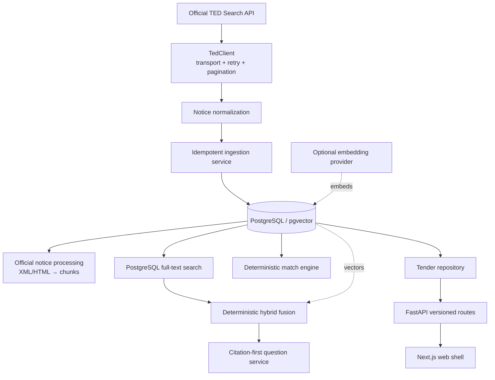

# TenderLens architecture

## Implemented scope

The implementation establishes a testable, Docker-first delivery path, official TED discovery ingestion, XML/HTML processing of official notice representations, lexical retrieval over citation-ready chunks, a deterministic reranker, source-only answer guardrails, structured extraction, company profiles, explainable matching, and a Next.js workspace. It also includes a pgvector HNSW index and provider boundaries for optional embeddings and LLM calls.

## Service boundaries

FastAPI routes contain validation and orchestration only. Source transport lives in `ingestion`, persistence access in `repositories`, and domain data in `models`/`schemas`.

## Database schema

| Entity | Purpose | Key integrity rule |
| --- | --- | --- |
| `buyers` | Contracting authority identity | unique `(name, country_code)` |
| `tenders` | Normalized published notice + raw metadata | unique `(source, source_id)` |
| `tender_documents` | Source document registration and processing state | cascading tender ownership |
| `document_chunks` | Citation-ready text units and future embeddings | unique `(document_id, chunk_index)` |

`tenders` records mandatory provenance (`source`, `source_id`, `source_url`, `ingested_at`) and permits sparse published metadata. `raw_metadata` is retained for reproducibility and later normalization upgrades. `document_chunks` includes document ID, page, section, index, and vector column, which is the minimum citation path for a future answer.

The current document processor chooses the official XML representation where TED provides one, falling back to official HTML. It extracts text without OCR, chunks deterministically, and never follows external procurement-platform links embedded in a notice. This keeps the source boundary explicit until attachment acquisition is designed separately.

## Retrieval and RAG guardrails

`document_chunks.search_vector` is a generated `tsvector` built with PostgreSQL's `simple` configuration and indexed with GIN. Lexical search uses `websearch_to_tsquery` and `ts_rank_cd`; it is functional without a model provider and is the default safe path.

The nullable pgvector column has an HNSW cosine-distance index. An embedding job batches currently unembedded chunks behind a provider interface. The included optional OpenAI adapter calls its embeddings endpoint with `text-embedding-3-small`; it is disabled unless both a provider and its key are supplied. The model choice was informed by [OpenAI's model documentation](https://developers.openai.com/api/docs/models/text-embedding-3-small). No embedding calls or semantic quality results are claimed without explicit deployment credentials and a measured corpus run.

When vectors exist, the hybrid retriever combines lexical and semantic ranked lists with reciprocal-rank fusion. A deterministic keyword reranker orders the small candidate set. The question service normalizes common question words conservatively, retrieves source chunks, and always attaches citations. Without a configured LLM it returns `evidence_only`; without retrieved evidence it returns `insufficient_evidence`.

The optional OpenAI provider uses the Responses API with `store: false` and Pydantic-derived JSON Schema for structured tender extraction. It is isolated behind `LLMProvider`, so no route or persistence code is coupled to a vendor. The API reference documents Responses as able to produce text or JSON outputs and to invoke custom tools. [OpenAI Responses API](https://developers.openai.com/api/reference/typescript/resources/beta/subresources/responses/methods/create)

## Deterministic matching

Company profiles retain structured services, skills, certifications, locations, CPV codes, languages, and contract-value preferences. `DeterministicMatcher` weights capability overlap (35%), skills (20%), eligibility (15%), location (10%), contract value (10%), and CPV (10%). It stores individual components, human-readable reasons, and potential blockers; an LLM is not allowed to calculate the score.

## Next steps

1. Add a larger, reviewed multilingual evaluation dataset before tuning weights or retrieval.
2. Add a configurable external reranker behind the existing boundary if the corpus requires it.
3. Add authentication and a background worker only when the product needs durable multi-user state or asynchronous throughput.

The LLM will never be the source of match scores, stored requirements, or citation metadata.

## Evaluation design (not yet measured)

Evaluation examples will live in `evaluation/datasets/` and contain a tender ID, question, expected answer, and expected evidence locations. A Docker-run script will write timestamped reports under `evaluation/reports/`; no results are committed or claimed before a real corpus exists.

Experiments will compare vector-only, hybrid, and hybrid-plus-reranking retrieval using Recall@1, Recall@5, and MRR. Answer evaluation will measure evidence/citation accuracy, answer correctness, faithfulness, latency, token usage, and estimated cost. Unit tests will keep citation construction and no-evidence behaviour deterministic without paid model calls.

## Operational choices

- PostgreSQL/pgvector is sufficient for the planned initial corpus; no separate search or queue service is introduced yet.
- The API waits for PostgreSQL health and applies Alembic migrations on startup.
- A background worker will be added only when document processing creates unacceptable request latency.
- Internal services use Compose service names (for example, `postgres`), never `localhost`.
