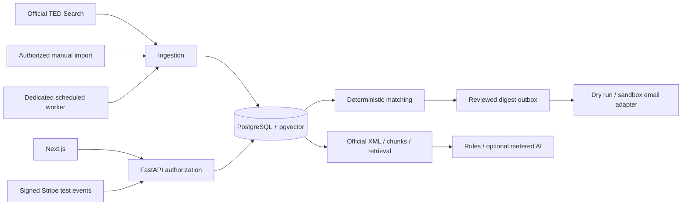

# Architecture

The existing procurement engine is retained. The commercial domain is added in
`backend/src/tenderlens/saas`; source acquisition, ranking, retrieval and evidence
remain in their original modules. Frontend page components call the versioned API
through a same-origin Next.js proxy. Secrets never enter the public bundle.

## Shared and private data

Public tender/buyer/document/chunk/requirement/analysis data is shared. Users,
organizations, memberships, sessions, action tokens, preferences, deliveries, usage,
audit events and leads have explicit ownership or internal operator access.
Company profiles reference organization_id; saved opportunities, matches and feedback
are reached only through a tenant-checked company. Null legacy ownership is private
and inaccessible, not implicitly assigned. Users may join more than one organization
and explicitly switch their server-side session after membership checks.

Roles: owner/admin manage profiles and membership, members work on opportunities.
Internal administration is independent of organization roles and checks a verified
operator email allowlist on the backend. Frontend visibility is convenience only.

## Identity and plans

Argon2 via pwdlib, random opaque cookie sessions hashed in DB, one-time verification/
reset tokens, database rate windows and Origin checks. No JWT trust in browser storage.
Plans and quotas are server configuration. Trial/active status controls entitled writes;
Stripe-signed webhooks refetch canonical subscription state and check provider identity.
Privacy export survives subscription expiry; deletion requests revoke sessions first.

## Background work

PostgreSQL jobs provide unique scheduling keys, claims, lease expiry, exponential retry,
bounded attempts and operator retry. Run one supported worker. Jobs cover ingestion,
matching, optional bounded candidate document/rules analysis, digest generation,
saved-deadline reminders, revision notifications and retention. A unique outbox key
prevents logical duplicate messages; provider idempotency supports delivery retry.
Dry run/manual review are defaults. Async timeouts do not preempt synchronous CPU work.

Ingestion retains source identity/raw payload, skips unchanged normalized records and
stores changed snapshots. Known exact date-time offsets survive normalization. Unknown
statuses and values remain explicit. Cross-publication version chains and complete
late-update reconciliation remain partial. Candidate/document processing is bounded;
external attachments and OCR remain unsupported.

## Evidence and cost

Rules operate without an LLM. Optional AI calls reserve a configured per-organization
budget before network I/O and track returned token estimates. Failures retain the
reservation conservatively. Costs are configurable estimates, not provider invoices.
Generated facts must occur in source chunks; answers that cannot be verified verbatim
fall back to evidence-only. Unmetered customer query embeddings are disabled; existing
operator embedding infrastructure remains optional.

## Deployment

One inexpensive EU host can run frontend, API, worker and PostgreSQL behind HTTPS,
with private DB, loopback service ports, persistent volume and off-host backups.
Docker builds use locked dependencies and unprivileged runtime users. Production
activation requires actual hosting, secrets, monitoring, restore rehearsal, legal and
accounting configuration, and explicit founder approval. No public deployment occurred.
